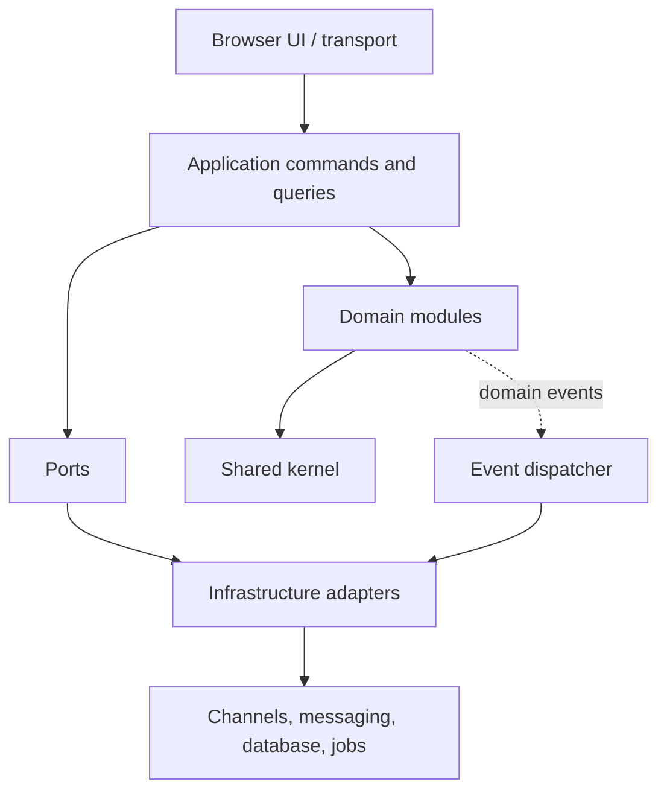
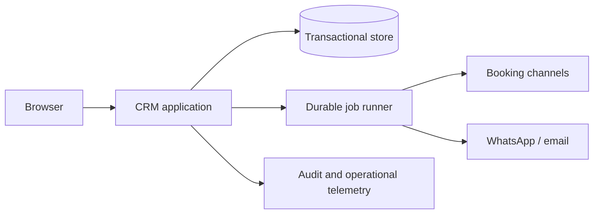

# Architecture Spine — Hotel CRM

## Design Paradigm

The system is a **modular monolith with hexagonal boundaries**:

- **Interface layer:** responsive browser UI and transport handlers.
- **Application layer:** commands, queries, authorization, transactions, and use-case orchestration.
- **Domain modules:** booking/inventory, guest, pricing, communication, automation, housekeeping, reporting, access, and property configuration.
- **Ports:** explicit contracts for persistence, channel sync, messaging, scheduling, notifications, and clock.
- **Adapters:** database, channel APIs, WhatsApp/email providers, job runner, and observability integrations.

Domain modules depend on shared primitives and ports, never on another module's persistence or adapter.

## Invariants & Rules

### AD-1 — One availability authority

- **Binds:** booking, inventory, channel sync
- **Prevents:** channel adapters, calendar screens, and manual booking flows calculating incompatible availability or double-booking rules
- **Rule:** Booking owns reservations, room assignment, overlap decisions, and sellable availability. Inventory owns room definitions and operational readiness only. All external and manual booking changes enter the booking application boundary; integrations never write availability directly.

### AD-2 — Explicit module ownership

- **Binds:** all domain modules
- **Prevents:** competing owners for guests, bookings, rooms, rates, messages, or audit records
- **Rule:** Each business entity has one owning module. Other modules use published commands, queries, or events and may keep only projections needed for their own reads.

### AD-3 — Commands and queries are separate paths

- **Binds:** all UI and integration use cases
- **Prevents:** reads mutating state, adapters bypassing authorization, and inconsistent transaction boundaries
- **Rule:** Queries are read-only. Mutations enter application commands, which authorize, validate, transact, persist, and publish the resulting domain event.

### AD-4 — Auditable, attributed mutation

- **Binds:** booking, pricing, guest, communication, housekeeping, automation, access, property configuration
- **Prevents:** untraceable operational changes and inability to explain pricing, status, or access decisions
- **Rule:** Every business mutation records actor or integration identity, property scope, timestamp, and a structured audit event. Audit history is append-only.

### AD-5 — Idempotent asynchronous work

- **Binds:** channel synchronization, pricing evaluation, automation, messaging, notifications, reporting projections
- **Prevents:** duplicate bookings, duplicate messages, repeated rate changes, and unsafe retries
- **Rule:** Every asynchronous operation has a stable idempotency key, retry policy, and terminal status. Failures and stale integrations are visible to operators; no failed operation becomes a success-shaped fallback.

### AD-6 — Property-scoped authorization

- **Binds:** every application command and query
- **Prevents:** role definitions drifting between screens, APIs, jobs, and integrations
- **Rule:** Authorization is enforced in the application layer using property scope and role permissions. UI visibility is convenience only, never the security boundary.

### AD-7 — Shared kernel stays small

- **Binds:** cross-module contracts
- **Prevents:** a shared model becoming a hidden dependency graph
- **Rule:** Shared code is limited to identifiers, property scope, actor identity, money, time, domain errors, event metadata, and pagination. Business entities and persistence models remain module-owned.

### AD-8 — Atomic event delivery

- **Binds:** all commands, domain events, projections, jobs, and external side effects
- **Prevents:** committed mutations with lost events, events for rolled-back changes, and incompatible retry/replay behavior
- **Rule:** The mutation and a versioned transactional-outbox record commit atomically. Dispatch occurs only after commit; consumers use a property-scoped idempotency key and aggregate sequence, with leases, bounded retries, dead-letter status, and operator replay.

### AD-9 — Property and temporal integrity

- **Binds:** all persisted records, commands, events, jobs, projections, cache keys, money, and schedules
- **Prevents:** cross-property leakage, wrong-property queued work, DST errors, and financial disagreement between modules
- **Rule:** Every tenant-owned record and operation carries immutable property scope. Instants persist in UTC; business dates and schedules use the property's IANA time zone. Money uses integer minor units plus ISO currency with one canonical rounding policy.

### AD-10 — Production degradation is explicit

- **Binds:** deployment, integrations, jobs, persistence, observability, and operator workflows
- **Prevents:** false success during outages, unrecoverable deployments, and silent data loss
- **Rule:** Development, test, and production are separate environments. Secrets are externalized; production has health/readiness checks, structured logs, metrics, backups, restore procedures, and visible stale/offline states. Provider failures produce retryable or operator-actionable outcomes, never silent success.

### Dependency direction



## Consistency Conventions

| Concern | Convention |
| --- | --- |
| Naming | Business terms from the PRD; module-owned entities use stable IDs; commands express intent, queries express retrieval, events use past-tense names. |
| Data & formats | Store instants in UTC and use the property's IANA time zone for business dates and schedules; represent money as integer minor units plus ISO currency; carry property ID, actor ID, correlation ID, causation ID, aggregate version, and idempotency key across commands and events. |
| State & cross-cutting | Mutate only through application commands; expose explicit loading, stale, failed, and retryable states; centralize authorization, audit metadata, structured errors, and configuration access. |
| External synchronization | Treat channel data as asynchronous; persist sync cursor/status and last-success time; reconcile through booking; unresolved conflicts fail closed for availability and create an operator task. |
| Contracts and persistence | Modules publish versioned command/event/query contracts; no cross-module table writes; projections are consumer-owned and expose freshness or aggregate position. |
| Audit and identity | Audit records are append-only and include subject, property, actor type, initiator/executor, source event, correlation, reason, and before/after or an explicit omission reason. |
| Responsive operations | Preserve the same use-case contracts across desktop and mobile; mobile interaction is an alternate interface, not a separate business path. Use the Material starter shell: drawer at large widths, rail at medium widths, and bottom navigation at compact widths. |
| Visual mock source | Treat `material-starter/dashboard.html` as the reference page; compose other pages from `tokens.css` and `components.css` without page-local colors, typography, or replacement primitives. |

## Stack

| Name | Version |
| --- | --- |
| Application runtime and framework | Deferred — no runtime exists in the current repository |
| Transactional persistence | Deferred — relational shape assumed, engine unselected |
| Durable jobs and event delivery | Deferred — required capability, provider unselected |
| Hosting and external channels | Deferred — provider and API contracts unselected |

## Structural Seed

```text
/
  src/
    interface/       # browser UI and transport handlers; material-starter is the visual mock seed
    application/     # commands, queries, policies, transactions
    modules/
      booking/       # bookings and room availability ownership
      inventory/     # rooms and room status ownership
      guest/
      pricing/
      communication/
      automation/
      housekeeping/
      reporting/
      access/
      property/
    shared/          # only the AD-7 shared kernel
    infrastructure/  # adapters and composition root
  migrations/
  tests/
```



Production environments are isolated from development and test. The primary store is backed up and restorable; job and sync freshness, provider connectivity, and degraded-mode states are observable to operators.

## Ownership and Contract Seed

| Business concept | Owner | Other modules receive |
| --- | --- | --- |
| Reservation, assignment, sellable availability | `booking` | versioned commands, events, and read projections |
| Room definition and operational readiness | `inventory` | status events and read projections |
| Guest identity, preferences, stay history | `guest` | guest-reference and profile contracts |
| Rates and pricing revisions | `pricing` | pricing decisions and revision events |
| Messages, delivery attempts, replies | `communication` | delivery outcome and reply events |
| Automation definitions and runs | `automation` | scheduled command/event contracts |
| Users, roles, authentication state | `access` | authorization decisions and actor identity |
| Audit records and event delivery records | `shared infrastructure` | append-only audit/event contracts |
| KPI and commission projections | `reporting` | read-only, freshness-marked projections |

## Capability → Architecture Map

| Capability / Area | Lives in | Governed by |
| --- | --- | --- |
| Booking and conflict prevention | `modules/booking` | AD-1, AD-3, AD-5 |
| Rooms and housekeeping status | `modules/inventory`, `modules/housekeeping` | AD-2, AD-4, AD-6 |
| Guest profiles and communication | `modules/guest`, `modules/communication` | AD-2, AD-4, AD-6 |
| Dynamic pricing | `modules/pricing` | AD-3, AD-4, AD-5 |
| Pre-arrival automation | `modules/automation` | AD-4, AD-5 |
| Reports and commission tracking | `modules/reporting` | AD-2, AD-5 |
| Users and access levels | `modules/access` | AD-4, AD-6 |
| Property and channel configuration | `modules/property`, infrastructure adapters | AD-1, AD-4, AD-6 |

## Deferred

- Concrete language, framework, database, queue, hosting, identity provider, and channel API choices; revisit before the first implementation slice.
- Exact provider-specific mapping and simultaneous-update reconciliation details; before channel adapters, implement the baseline fail-closed policy and versioned conflict task defined by AD-1, AD-5, and AD-10.
- Multi-property tenancy and portfolio rollups; v1 scope is one property per operating context.
- Guest-facing portal, advanced forecasting, ERP/accounting integrations, and multilingual expansion; revisit after MVP validation.
- Detailed schema, API payloads, observability vendors, and CI/CD mechanics; let the selected implementation stack own these after the boundary rules are accepted.
