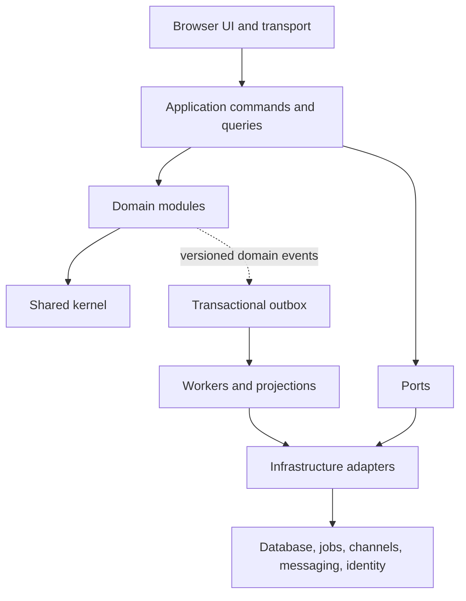
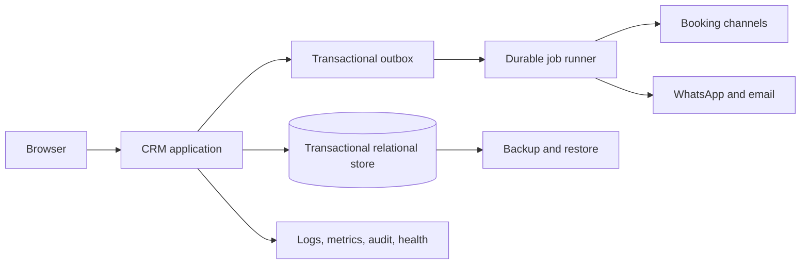

# Architecture Spine — Hotel CRM

## Design Paradigm

The system is a **modular monolith with hexagonal boundaries**:

- `interface`: responsive browser UI and transport handlers.
- `application`: commands, queries, authorization, transactions, and use-case orchestration.
- `modules`: booking, inventory, guest, pricing, communication, automation, housekeeping, reporting, access, and property configuration.
- `shared`: a deliberately small kernel of identifiers, property scope, actor identity, money, time, errors, event metadata, and pagination.
- `infrastructure`: persistence, transactional outbox, job execution, channel/messaging adapters, authentication, and observability.

Each module owns its tables, repositories, and persistence schema behind ports. Infrastructure hosts the database adapter, composition root, outbox, and workers but owns no business tables. Ports define external contracts. Adapters implement ports. No module reaches into another module's persistence or adapter.



## Invariants & Rules

### AD-1 — Booking owns sellable availability

- **Binds:** booking, inventory, channel synchronization, calendar UI
- **Prevents:** competing overlap rules, double-bookings, and channel-specific availability calculations
- **Rule:** Booking owns reservations, room assignment, overlap decisions, and sellable availability. Reservation lifecycle states are `pending`, `confirmed`, `modified`, `cancelled`, `no_show`, `checked_in`, and `checked_out`; only `confirmed`, `modified`, and `checked_in` hold assigned nights, while cancellation and no-show release nights according to the recorded effective time. Inventory owns room definitions and the canonical readiness state machine (`out_of_order`, `dirty`, `inspect`, `clean`, `ready`) with versioned transitions. Housekeeping submits inventory commands and cannot persist readiness directly. Only `out_of_order` removes a room from sellable availability; `dirty`, `inspect`, and `clean` affect operational readiness but not future inventory. An out-of-order transition overlapping a reservation must atomically commit the booking outcome and readiness transition by reassigning or cancelling the affected stay, or be rejected; partial-night overlap cannot be confirmed. Missing, unknown, or stale readiness never creates new sellable inventory and leaves existing reservations unchanged pending reconciliation. A booking command rejects a missing or cross-property room and rejects `check_in >= check_out`. Every manual or external booking change enters a booking application command.

### AD-2 — Each business entity has one owner

- **Binds:** all domain modules
- **Prevents:** competing owners and incompatible representations of guests, bookings, rooms, rates, messages, users, and audit records
- **Rule:** Ownership is assigned to one module. Other modules consume versioned commands, queries, events, or consumer-owned projections; cross-module table writes are forbidden.

### AD-3 — Commands and queries are separate paths

- **Binds:** every UI, API, integration, and job use case
- **Prevents:** reads that mutate state, bypassed authorization, and inconsistent transaction boundaries
- **Rule:** Queries are read-only. Commands authorize, validate, transact, persist, audit, and publish event intent through the application boundary. Interactive commands require a property-scoped typed idempotency key; a same-key retry returns the original result, overlapping stays are rejected by the transactional availability constraint, and a key collision with different payloads is rejected.

### AD-4 — Mutations are attributed and auditable

- **Binds:** booking, inventory, pricing, guest, communication, housekeeping, automation, access, property configuration
- **Prevents:** untraceable operational changes and inability to explain pricing, status, access, or communication decisions
- **Rule:** Every business mutation records property scope, actor or integration identity, timestamp, correlation ID, causation ID, subject, reason, and before/after values or an explicit omission reason. Audit history is append-only.

### AD-5 — Asynchronous work is idempotent and failure-visible

- **Binds:** channel sync, messaging, pricing evaluation, automation, reporting projections, notifications
- **Prevents:** duplicate bookings, messages, rate changes, projections, and unsafe retries
- **Rule:** Each asynchronous operation has a typed, property-scoped idempotency key, retry policy, lease/claim state, terminal status, and operator-visible failure or stale state. Keys are unique for the durable replay horizon; an expired key returns a typed rejection and is never silently reused. Claims use monotonically increasing fencing tokens; state transitions and external attempts are conditional on the current token, so expired workers cannot complete work. Every external attempt carries a durable provider request ID when supported; when not supported, retry first reconciles the unknown outcome and leaves it unknown, blocking retry, when reconciliation is inconclusive. A configured alternate-channel fallback is allowed only as a new recorded attempt; the original provider failure, every attempt, and final outcome remain visible and auditable. A fallback must not be recorded as success of the original attempt.

### AD-6 — Authorization is property-scoped

- **Binds:** every application command and query
- **Prevents:** permission drift between screens, APIs, jobs, and integrations
- **Rule:** Application policies enforce property scope and role permissions. At enqueue and execution, actor, credential reference, aggregate, cache key, adapter configuration, destination, and command envelope must resolve to the same property; mismatches are rejected, and revoked permissions stop leased work at its next execution check. UI visibility is convenience only. v1 roles are owner-admin (one role), manager, front desk, housekeeping, and read-only reporting; sensitive rate, access, channel, and configuration actions require explicit permissions from the shared matrix below.

### AD-7 — The shared kernel stays small

- **Binds:** cross-module contracts
- **Prevents:** a shared model becoming a hidden dependency graph
- **Rule:** Shared code is limited to identifiers, property scope, actor identity, money, time, domain errors, event metadata, pagination, and contract primitives. Business entities and persistence models remain module-owned.

### AD-8 — State and event intent commit atomically

- **Binds:** commands, domain events, projections, jobs, and external side effects
- **Prevents:** committed mutations with lost events, events for rolled-back changes, and incompatible replay behavior
- **Rule:** A mutation and its versioned transactional-outbox record commit atomically. Dispatch occurs only after commit. Events use contiguous monotonic sequence numbers per aggregate. Consumers atomically advance projection state with the last-applied sequence; duplicates are ignored, gaps pause consumption until timeout, and timeout quarantines the consumer until operator replay fills the gap. Terminally rejected events create an operator-visible failure. Dead-letter status, freshness, and operator replay are observable.

### AD-9 — Property and temporal integrity are explicit

- **Binds:** persisted records, commands, events, jobs, projections, cache keys, money, schedules, and external credential references
- **Prevents:** cross-property leakage, wrong-property queued work, DST errors, and financial disagreement
- **Rule:** Every tenant-owned record and operation carries immutable property scope. Validate property binding at enqueue and execution. Distinguish `Instant`, property `LocalDate`, and property zoned-local date-time contracts. Persist instants in UTC; represent stays as half-open `[check_in, check_out)` local-date intervals and reject non-positive intervals; resolve DST gaps by moving to the next valid instant and folds by the earlier offset unless a schedule explicitly selects otherwise. Represent money as integer minor units plus ISO currency using a shared currency registry; calculate base rate, discounts, taxes, fees, commission, and FX in that order; round line items half-up to currency exponent, round totals only after aggregation, reject negative payable totals unless the operation is an explicit refund/credit, and reject conversion when the required immutable FX-rate version is missing.

### AD-10 — Availability conflicts fail closed

- **Binds:** channel synchronization and manual conflict resolution
- **Prevents:** selling uncertain inventory during simultaneous or partially failed updates
- **Rule:** Channel data is asynchronous and never authoritative over booking. A conflict is identified by property, room or room type, half-open date interval, source, and provider version. The blocking ladder is room, then room type, then property, always for the conflict interval only; missing room blocks its room type, missing room type blocks that property's matching interval, and unbounded scope is rejected. Resolution commands are limited to accept, reject, reassign, or supersede with an explicit booking outcome; each re-checks overlap inside the booking transaction, rejects reassignment when no room is free, and leaves the conflict open when reconciliation is inconclusive. Every resolution is audited.

### AD-11 — The operational envelope is production-safe

- **Binds:** deployment, integrations, jobs, persistence, observability, and operator workflows
- **Prevents:** false success during outages, unrecoverable deployments, silent data loss, and untestable recovery
- **Rule:** Development, test, and production are separate environments. Secrets are externalized. Production requires health/readiness checks, structured logs, metrics for job and sync freshness, backups, restore procedures, and visible degraded/offline states.

### AD-12 — One use-case contract serves every viewport

- **Binds:** responsive browser UI, accessibility, and operational workflows
- **Prevents:** mobile and desktop paths implementing different business behavior
- **Rule:** Desktop, tablet, and mobile use the same application contracts. The Material shell uses drawer at large widths, rail at medium widths, and bottom navigation at compact widths. Statuses use text plus color; focus, keyboard navigation, reduced motion, screen-reader labels, and minimum touch targets are required.

### AD-13 — Guest follow-up work has one owner

- **Binds:** guest replies, internal notes, follow-up tasks, communication, automation
- **Prevents:** guest follow-up state being split between communication, automation, housekeeping, or an ad hoc shared model
- **Rule:** Communication owns the guest-conversation thread, generic guest follow-up tasks, and internal notes. Housekeeping separately owns room-turnover tasks. Communication creates versioned task commands; each task has property scope, subject booking/guest, assignee or queue, status, due time, actor, and audit history. Automation may propose or schedule a task but does not own its completion state.

### AD-14 — Performance and recovery budgets are explicit

- **Binds:** dashboard, booking grid, commands, projections, persistence, deployment, backup, and operations
- **Prevents:** independently acceptable components producing a slow or unrecoverable system
- **Rule:** Before the first implementation slice, the release plan must set provisional measurable budgets for dashboard/booking-grid read latency, command persistence latency, availability, durability, and job freshness, plus RPO/RTO. Measured baselines may refine them before production launch. Production backups require retention and restore verification; schema changes are backward-compatible during rollout; deployments support rollback or forward-fix; an explicitly named operations owner maintains the recovery runbook. No production launch is complete without these targets and tests.

### AD-15 — Accepted prices are immutable decisions

- **Binds:** pricing, booking, reporting, commission tracking, channel synchronization
- **Prevents:** later pricing-rule changes rewriting historical booking totals or producing incompatible ADR and commission calculations
- **Rule:** Every accepted booking price stores an unexpired quoted pricing-decision ID, pricing revision, effective interval, currency, component breakdown, and input snapshot. A changed date range, occupancy, room, currency, or expired quote requires a new decision; the original accepted snapshot remains immutable. Reporting and commission calculations use that accepted snapshot, never re-evaluate current pricing rules.

### AD-16 — Contract versions have one compatibility policy

- **Binds:** commands, events, projections, jobs, adapters, and replay
- **Prevents:** consumers deriving different state from the same versioned contract
- **Rule:** Contract changes are additive within a supported compatibility window; consumers accept the current and previous versions, unknown versions are quarantined without advancing position, and upgrades precede producers. Replay uses the contract version recorded with the event and requires an explicit migration for incompatible changes.

### AD-17 — Reporting metrics are versioned business contracts

- **Binds:** reporting, dashboard, commission tracking, exports, and financial reconciliation
- **Prevents:** different occupancy, ADR, RevPAR, cancellation, refund, and commission results from the same bookings
- **Rule:** Each metric definition versions its property business-date cutoff (local midnight), local-date attribution, inclusion/exclusion rules, cancellation/refund treatment, denominator behavior, accepted-price basis, and commission basis. Projections and exports identify the metric-definition version used.

## Consistency Conventions

| Concern | Convention |
| --- | --- |
| Naming and data | Use PRD business terms. Commands express intent, queries express retrieval, and events use past tense. IDs are stable and opaque. Carry property ID, actor ID, correlation ID, causation ID, aggregate version, and idempotency key in command/event envelopes. Use explicit `Instant`, `LocalDate`, and zoned-local date-time types; use half-open stay intervals; persist UTC instants; use property IANA time zones for business dates; use the shared minor-unit money and currency-calculation contract. |
| State and errors | Mutate only through application commands. Expose loading, stale, failed, retryable, and degraded states. Errors are structured and actionable, never silent. |
| Contracts and persistence | Publish versioned contracts under AD-16. No cross-module table writes. Projections are consumer-owned and expose freshness or last-applied position. |
| Audit and identity | Audit records are append-only and include subject, property, actor type, initiator/executor, source event, correlation, reason, and before/after or omission reason. |
| External synchronization | Store provider cursor/status and last-success time. Use durable provider request IDs or reconcile unknown outcomes before retry. Reconcile through booking. Fail closed for unresolved availability conflicts. |
| Interface and accessibility | Reuse Material starter tokens/components; keep status labels alongside color; provide visible focus, keyboard paths, reduced-motion behavior, screen-reader names, and 44px/48px touch targets. |

## Stack

| Name | Version |
| --- | --- |
| Application runtime and framework | Deferred — no runtime exists in the repository |
| Transactional persistence | Deferred — relational shape assumed, engine unselected |
| Durable jobs and event delivery | Deferred — required capability, provider unselected |
| Identity and authentication | Deferred — role model is fixed, provider unselected |
| Hosting and external channels | Deferred — provider and API contracts unselected |

## Structural Seed

```text
/
  src/
    interface/         # browser UI and transport handlers
    application/       # commands, queries, policies, transactions
    modules/
      booking/         # reservations, assignment, sellable availability
      inventory/       # rooms and operational readiness
      guest/           # identity, preferences, stay history
      pricing/         # rules, revisions, pricing decisions
      communication/   # messages, delivery attempts, replies
      automation/      # definitions, triggers, runs, fallback
      housekeeping/    # tasks and room-turnover coordination
      reporting/       # read-only KPI and commission projections
      access/          # users, roles, authentication state
      property/        # property and channel configuration
    shared/            # AD-7 kernel only
    infrastructure/    # adapters, outbox, workers, composition root
  migrations/          # module-owned migrations; no shared business schema
  tests/
```



Production environments are isolated from development and test. The primary store is backed up and restorable; job freshness, provider connectivity, sync status, and degraded states are operator-visible.

## Ownership and Contract Seed

| Business concept | Owner | Other modules receive |
| --- | --- | --- |
| Reservation, assignment, sellable availability | `booking` | versioned commands, events, and read projections |
| Room definition and operational readiness | `inventory` | status events and read projections |
| Guest identity and preferences | `guest` | guest-reference and profile contracts |
| Guest stay history | `guest` | booking-event projection only; no direct mutation |
| Rates and pricing revisions | `pricing` | pricing decisions and revision events |
| Messages, delivery attempts, replies, generic follow-up tasks, internal notes | `communication` | delivery outcome, reply, and task contracts |
| Automation definitions and runs | `automation` | scheduled command/event contracts |
| Housekeeping tasks and acknowledgements | `housekeeping` | room-readiness events and task projections |
| Users, roles, authentication state | `access` | authorization decisions and actor identity |
| Property, channel configuration, and versioned commission terms | `property` | configuration projections and adapter settings |
| KPI and commission projections | `reporting` | read-only, freshness-marked projections |
| Audit records and event delivery records | `infrastructure` | append-only audit and event contracts |

### Permission matrix

Application policies use this single property-scoped matrix; interfaces, jobs, and adapters do not define additional permissions.

| Capability | Owner-admin | Manager | Front desk | Housekeeping | Read-only reporting |
| --- | --- | --- | --- | --- | --- |
| View operational data | All | All | Operational | Assigned readiness/tasks | Reports only |
| Create or edit bookings | Yes | Yes | Yes | No | No |
| Override conflicts or reassign rooms | Yes | Yes | No | No | No |
| Edit pricing rules or channel settings | Yes | Yes | No | No | No |
| Update room readiness / housekeeping tasks | Yes | Yes | No | Yes | No |
| Send guest messages / manage follow-up | Yes | Yes | Yes | Assigned tasks only | No |
| Manage users, roles, property settings, commission terms | Yes | No | No | No | No |
| View reports and exports | Yes | Yes | Limited | No | Yes |

## Capability → Architecture Map

| Capability / Area | Lives in | Governed by |
| --- | --- | --- |
| Unified calendar, manual booking, conflict prevention | `modules/booking` | AD-1, AD-3, AD-5, AD-10 |
| Rooms and housekeeping readiness | `modules/inventory`, `modules/housekeeping` | AD-2, AD-4, AD-6, AD-12 |
| Guest profiles, communication history, and follow-up work | `modules/guest`, `modules/communication` | AD-2, AD-4, AD-6, AD-9, AD-13 |
| Dynamic occupancy pricing and revisions | `modules/pricing` | AD-3, AD-4, AD-5, AD-9, AD-15 |
| Pre-arrival and operational automation | `modules/automation` | AD-4, AD-5, AD-8 |
| KPI, ADR, RevPAR, commission, and exports | `modules/reporting` | AD-2, AD-5, AD-8, AD-15, AD-17 |
| Users, roles, login, and access levels | `modules/access` | AD-4, AD-6, AD-9 |
| Property setup and channel connections | `modules/property`, infrastructure adapters | AD-1, AD-4, AD-6, AD-10 |
| Responsive operational interface | `interface`, Material starter shell | AD-3, AD-6, AD-12, AD-14 |

## Deferred

- Concrete language, framework, database engine, job runner, hosting, identity provider, channel APIs, messaging provider, and observability vendors; select and verify them before the first implementation slice.
- Exact provider mapping, rate limits, webhook/polling strategy, simultaneous-update reconciliation, and credential rotation; decide before channel adapters.
- Detailed schema, API payloads, provider-specific runbooks, and CI/CD tooling; let the selected implementation stack own them while preserving these invariants. The implementation plan must make AD-14's latency, availability, durability, RPO/RTO, restore, compatibility, rollback, and ownership values concrete before production.
- Multi-property tenancy and portfolio rollups; v1 is one property per operating context, while property scope is retained in the data model.
- User-to-property cardinality and active-property selection; before a second property is supported, define whether users may belong to multiple properties, require an explicit active-property context in sessions, and re-check that context on every command and job execution.
- Guest-facing portal, advanced forecasting, ERP/accounting integrations, and multilingual expansion; revisit after MVP validation.
- Offline write queue semantics beyond the UX requirement for visible failure and retry; define before promising reliable mutation during connectivity loss.
- Performance and recovery targets are intentionally provisional rather than numerically fixed here; set them before the first implementation slice, then refine them from measured baselines before production readiness.
- Exact metric formulas and contract compatibility windows are deferred until the first reporting and integration slices, but must be versioned under AD-16 and AD-17 before those slices ship.
